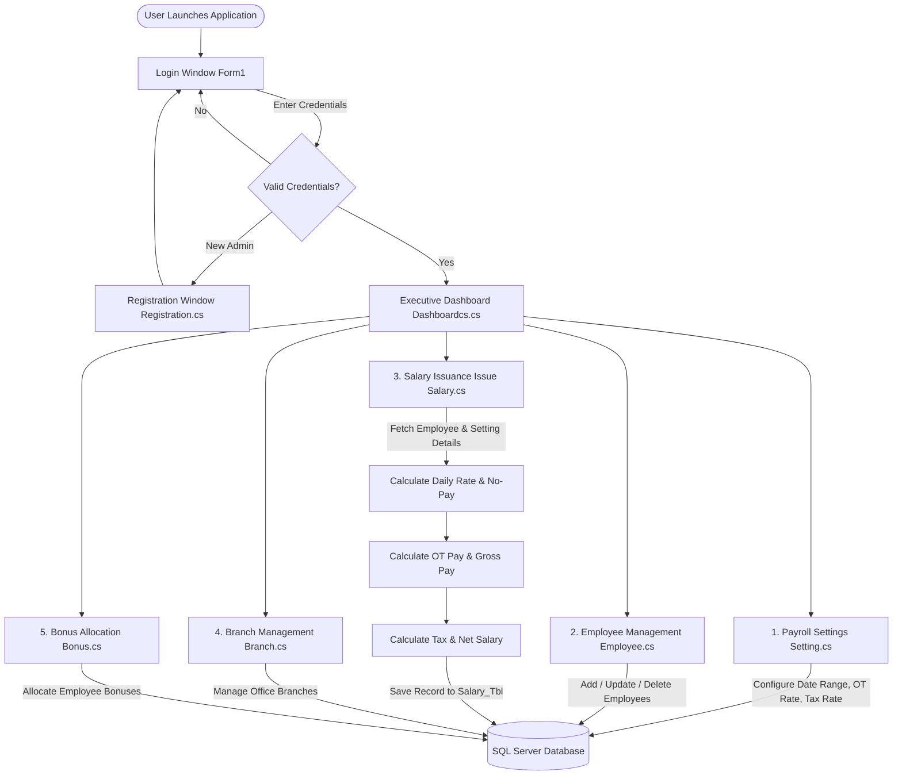

# Grifindo Toys - Payroll & Employee Management System


A complete enterprise desktop management solution developed for **Grifindo Toys**, providing end-to-end automation for employee administration, salary calculations, payroll settings, branch operations, bonuses, and role-based authentication.

---

## 📌 Table of Contents

- [📖 1. System Overview](#-1-system-overview)
- [🔄 2. How the System Works (Operational Workflow)](#-2-how-the-system-works-operational-workflow)
- [📦 3. System Components & Features (What's Included)](#-3-system-components--features-whats-included)
- [🗄️ 4. Database Setup & Connection Guide](#-4-database-setup--connection-guide)
  - [4.1 Database Architecture](#41-database-architecture)
  - [4.2 Connection String Configuration](#42-connection-string-configuration)
  - [4.3 How to Connect & Attach the Database](#43-how-to-connect--attach-the-database)
- [⚡ 5. How to Run the System (Step-by-Step Guide)](#-5-how-to-run-the-system-step-by-step-guide)
- [🔑 6. Default Login Credentials](#-6-default-login-credentials)
- [🧮 7. Salary & Payroll Calculation Logic](#-7-salary--payroll-calculation-logic)
- [📂 8. Project File Structure](#-8-project-file-structure)
- [🛠️ 9. Troubleshooting & FAQs](#️-9-troubleshooting--faqs)

---

## 📖 1. System Overview

The **Grifindo Toys Payroll & Management System** was built to replace error-prone manual spreadsheets and paperwork with an automated, secure Windows Forms application.

### Key Capabilities:
- **Centralized Employee Records:** Complete profiles including personal data, designations, and salary structures.
- **Configurable Payroll Cycles:** Flexibility to adjust monthly salary cycle start/end dates, tax deductions, and hourly overtime rates without modifying source code.
- **Accurate Automated Salary Calculation:** Real-time computation of Overtime (OT), Gross Pay, No-Pay deductions based on absent days, and Government Tax.
- **Branch & Incentive Management:** Manage company branches and assign performance bonuses.
- **Modern User Interface:** Built using **Krypton Suite** controls for a sleek, modern, styled desktop experience.

---

## 🔄 2. How the System Works (Operational Workflow)

The system follows a structured operational workflow from authentication to monthly salary issuance:



### Detailed Execution Process:
1. **Authentication:** The user logs in via `Form1.cs`. Credentials are authenticated against `Login_Tbl`. New administrators can register via `Registration.cs`.
2. **Dashboard Navigation:** Upon successful login, `Dashboardcs.cs` displays key statistics (e.g., active employee count) and provides fast shortcuts to all operational modules.
3. **Payroll Cycle Configuration:** Before issuing salaries, the HR administrator defines the active cycle in `Setting.cs` (e.g., cycle start date, end date, overtime hourly rate, and applicable tax rate percentage).
4. **Employee Onboarding:** Staff records (personal details, department/position, join date, base salary) are managed in `Employee.cs`.
5. **Salary Calculation & Issuance:** 
   - In `Issue Salary.cs`, the user selects an employee and payroll setting.
   - Entering **Present Days** automatically computes **Absent Days** (`30 - Present Days`).
   - The system automatically derives:
     - **No-Pay Deduction** = `(Monthly Salary / 30) * Absent Days`
     - **OT Pay** = `OT Hours * OT Rate`
     - **Gross Pay** = `Monthly Salary + Allowances + OT Pay`
     - **Government Tax** = `Gross Pay * (Tax Rate / 100)`
     - **Net Salary** = `Gross Pay - No Pay - Government Tax`
   - The generated salary payslip is recorded into `Salary_Tbl` and displayed in the real-time history grid.
6. **Branch & Bonus Records:** Departmental branches and annual/incentive bonuses are tracked through `Branch.cs` and `Bonus.cs`.

---

## 📦 3. System Components & Features (What's Included)

### 🖥️ Modules & UI Forms:
| Component / Form | Description & Core Functionality |
| :--- | :--- |
| **`Form1.cs`** | **Authentication Portal:** Validates usernames and passwords against SQL Server. Supports remember-me and navigation to registration. |
| **`Registration.cs`** | **User Registration:** Creates new administrator accounts with first name, last name, email, contact, DOB, username, and password validation. |
| **`Dashboardcs.cs`** | **Executive Dashboard:** Centralized hub featuring real-time statistics (total employees, managers) and quick access buttons to every sub-module. |
| **`Employee.cs`** | **Employee Directory:** CRUD operations for employee master data (`Emp_ID`, `Name`, `Address`, `Gender`, `DOB`, `Contact`, `Position`, `Join_Date`, `Monthly_Salary`). |
| **`Setting.cs`** | **Payroll Settings:** Defines the salary cycle duration (`Start_date`, `End_date`), hourly `Ot_rate`, and government `Tax_rate`. |
| **`Issue Salary.cs`** | **Payroll Engine:** Dynamic calculation interface for computing daily rates, overtime earnings, no-pay deductions, gross income, tax, and net remuneration. |
| **`Branch.cs`** | **Branch Administration:** Tracks company office locations, branch names, contact details, and branch IDs. |
| **`Bonus.cs`** | **Bonus Tracking:** Records bonus rewards, amounts, assigned employees, and disbursement dates. |
| **`Base_Pay.cs`**, **`Gross_Pay.cs`**, **`Net_Paycs.cs`**, **`No_Pay.cs`** | Dedicated calculation helper interfaces and breakdown dialogs. |

### 🛠️ Technologies & Libraries:
- **Language:** C# 7.3 / 8.0
- **Framework:** .NET Framework 4.8 / 4.7.2
- **UI Framework:** Windows Forms with **Krypton Suite 4.5.9** (`ComponentFactory.Krypton.Toolkit`, `ComponentFactory.Krypton.Navigator`)
- **Data Access:** ADO.NET (`System.Data.SqlClient`) with parameterized queries
- **Database Engine:** Microsoft SQL Server (LocalDB `MSSQLLocalDB` or full SQL Server instance)

---

## 🗄️ 4. Database Setup & Connection Guide

### 4.1 Database Architecture
The database consists of 7 primary tables stored in the SQL Server MDF file (`Grifindo_Toys.mdf`):

```text
Grifindo_Toys (Database)
 ├── Login_Tbl        (User credentials & administrator profiles)
 ├── Employee_Tbl     (Employee master records & salary levels)
 ├── Setting_Tbl      (Salary cycle dates, OT rate, Tax rate)
 ├── Salary_Tbl       (Issued salary records, deductions, allowances)
 ├── Branch_Tbl       (Branch details & contact info)
 ├── Bonus_Tbl        (Employee bonus allocations)
 └── Attendance_Tbl   (Attendance tracking records)
```

---

### 4.2 Connection String Configuration

The connection string is centrally defined in [`Grifindo Toys/DbConfig.cs`](Grifindo%20Toys/DbConfig.cs) and mirrored in [`Grifindo Toys/App.config`](Grifindo%20Toys/App.config).

#### 📍 Default Configuration (`DbConfig.cs`):
```csharp
namespace Grifindo_Toys
{
    public static class DbConfig
    {
        public static readonly string ConnectionString = 
            @"Data Source=(LocalDB)\MSSQLLocalDB;Initial Catalog=Grifindo_Toys;Integrated Security=True";
    }
}
```

#### 🔄 How to Customize for Your Environment:

- **Option A: Using SQL Server LocalDB with Direct File Attachment:**
  ```csharp
  public static readonly string ConnectionString = 
      @"Data Source=(LocalDB)\MSSQLLocalDB;AttachDbFilename=|DataDirectory|\Grifindo_Toys.mdf;Integrated Security=True";
  ```

- **Option B: Using Full Microsoft SQL Server (Windows Authentication):**
  ```csharp
  public static readonly string ConnectionString = 
      @"Data Source=localhost;Initial Catalog=Grifindo_Toys;Integrated Security=True";
  ```

- **Option C: Using SQL Server Authentication (Username & Password):**
  ```csharp
  public static readonly string ConnectionString = 
      @"Data Source=localhost;Initial Catalog=Grifindo_Toys;User ID=sa;Password=YourPassword123;";
  ```

---

### 4.3 How to Connect & Attach the Database

Choose one of the following methods to connect the database to your computer:

#### 🔹 Method 1: Using SQL Server LocalDB (Recommended - Simplest)
1. Open PowerShell or Command Prompt on your computer.
2. Check if LocalDB is installed and start the `MSSQLLocalDB` instance:
   ```cmd
   sqllocaldb create MSSQLLocalDB
   sqllocaldb start MSSQLLocalDB
   ```
3. To verify the status, run:
   ```cmd
   sqllocaldb info MSSQLLocalDB
   ```
4. If the database was previously detached, attach `Grifindo_Toys.mdf` using Visual Studio:
   - In Visual Studio, go to **View** ➡️ **SQL Server Object Explorer** (or **Server Explorer**).
   - Right-click **Data Connections** ➡️ **Add Connection...**
   - Server name: `(localdb)\MSSQLLocalDB`
   - Select or attach `Grifindo_Toys.mdf` from your project folder:
     `c:\...\Grifindo-Toys\Grifindo Toys\Grifindo_Toys.mdf`
   - Click **Test Connection** to confirm success.

#### 🔹 Method 2: Using SQL Server Management Studio (SSMS)
1. Open **Microsoft SQL Server Management Studio (SSMS)**.
2. Connect to your local SQL Server instance:
   - Server Name: `(localdb)\MSSQLLocalDB` or `.` or `localhost`
   - Authentication: **Windows Authentication**
3. In **Object Explorer**, right-click **Databases** ➡️ Select **Attach...**
4. Click **Add** and navigate to your project folder:
   `...\Grifindo-Toys\Grifindo Toys\Grifindo_Toys.mdf`
5. Ensure the database name is `Grifindo_Toys` and click **OK**.

---

## ⚡ 5. How to Run the System (Step-by-Step Guide)

### 📋 Prerequisites
Before running the application, make sure your PC has:
1. **Windows 10 / 11** (64-bit recommended).
2. **Visual Studio 2022** (Community, Professional, or Enterprise).
   - Ensure the **.NET desktop development** workload is selected during installation.
   - Includes **.NET Framework 4.8 Developer Pack** and **SQL Server Express LocalDB**.
3. **Microsoft SQL Server LocalDB** or standard SQL Server.

---

### 🚀 Step-by-Step Execution:

#### Step 1: Clone or Download the Project
Open terminal and clone the repository:
```bash
git clone https://github.com/Pasan-Pramuditha/Grifindo-Toys.git
cd Grifindo-Toys
```

#### Step 2: Ensure the Database Service is Running
Run the following in PowerShell/CMD:
```cmd
sqllocaldb start MSSQLLocalDB
```

#### Step 3: Open the Solution in Visual Studio
- Double-click [`Grifindo Toys.sln`](Grifindo%20Toys.sln) to launch the project in Visual Studio 2022.

#### Step 4: Verify Krypton Suite References
- The UI controls are powered by **Krypton Suite 4.5.9**.
- The project is pre-configured with relative library references pointing directly to `packages/Krypton.Components.Suite.4.5.9/lib/net40/`:
  - `ComponentFactory.Krypton.Toolkit.dll`
  - `ComponentFactory.Krypton.Navigator.dll`
  - `ComponentFactory.Krypton.Ribbon.dll`
  - `ComponentFactory.Krypton.Workspace.dll`
- If needed, right-click the solution in Solution Explorer and select **Restore NuGet Packages**.

#### Step 5: Build the Solution
- Select build mode: **Debug** | **Any CPU** (or `x64` / `x86`).
- Press **`Ctrl + Shift + B`** or click **Build** ➡️ **Build Solution**.
- Ensure the Output window reports `Build: 1 succeeded, 0 failed`.

#### Step 6: Start the Application
- Press **`F5`** (with debugging) or **`Ctrl + F5`** (without debugging), or click the green **Start** button in Visual Studio.
- The system will boot up and present the **Login Window (`Form1`)**.

---

## 🔑 6. Default Login Credentials

Use the default administrative credentials to sign in:

| Parameter | Value | Note |
| :--- | :--- | :--- |
| **Username** | `admin` | Pre-configured Administrator |
| **Password** | `admin` | Case-sensitive |

> 💡 **Tip:** You can also register custom accounts by clicking the **Register** button on the login screen.

---

## 🧮 7. Salary & Payroll Calculation Logic

The payroll calculation formulas implemented within `Issue Salary.cs` operate as follows:

$$ \text{Daily Rate} = \frac{\text{Monthly Salary}}{30} $$

$$ \text{Absent Days} = 30 - \text{Present Days} $$

$$ \text{No Pay Deduction} = \text{Daily Rate} \times \text{Absent Days} $$

$$ \text{OT Pay} = \text{OT Hours} \times \text{OT Rate} $$

$$ \text{Gross Pay} = \text{Monthly Salary} + \text{Allowances} + \text{OT Pay} $$

$$ \text{Government Tax} = \text{Gross Pay} \times \left(\frac{\text{Tax Rate}}{100}\right) $$

$$ \mathbf{\text{Net Salary}} = \text{Gross Pay} - \text{No Pay} - \text{Government Tax} $$

---

## 📂 8. Project File Structure

```text
Grifindo-Toys/
│
├── Grifindo Toys.sln                     # Visual Studio Solution File
├── README.md                             # Comprehensive project documentation
├── .gitignore                            # Git ignore configuration
│
├── packages/                             # NuGet packages & UI component libraries
│   └── Krypton.Components.Suite.4.5.9/   # Krypton Toolkit & Navigator DLLs
│
└── Grifindo Toys/                        # Main C# WinForms Project
    ├── App.config                        # Application & DB connection settings
    ├── DbConfig.cs                       # Centralized SQL Connection String provider
    ├── Program.cs                        # Application entry point (Main)
    ├── Grifindo Toys.csproj              # Project configuration and dependency links
    │
    ├── Form1.cs                          # Login Window
    ├── Registration.cs                   # Admin Registration Window
    ├── Dashboardcs.cs                    # Main Executive Dashboard
    ├── Employee.cs                       # Employee Management CRUD Form
    ├── Setting.cs                        # Salary Cycle, OT Rate & Tax Settings Form
    ├── Issue Salary.cs                   # Salary Calculation & Payroll Issuance Form
    ├── Branch.cs                         # Branch Management Form
    ├── Bonus.cs                          # Employee Bonus Form
    │
    ├── Base_Pay.cs                       # Base pay calculation dialogue
    ├── Gross_Pay.cs                      # Gross pay calculation dialogue
    ├── Net_Paycs.cs                      # Net salary calculation dialogue
    ├── No_Pay.cs                         # No-pay deduction dialogue
    │
    ├── Grifindo_Toys.mdf                 # SQL Server Database primary data file
    ├── Grifindo_Toys_log.ldf             # SQL Server Database log file
    ├── Grifindo_ToysDataSet.xsd          # Typed DataSet schema for Employee data
    ├── Grifindo_ToysDataSet1.xsd         # Typed DataSet schema for Attendance data
    └── Resources/                        # UI Icons, logos, and graphic assets
```

---

## 🛠️ 9. Troubleshooting & FAQs

| Error / Issue | Root Cause | Solution |
| :--- | :--- | :--- |
| **"Cannot connect to SQL Server" / SqlException** | LocalDB instance is stopped or not created | Open CMD and execute: <br>`sqllocaldb create MSSQLLocalDB`<br>`sqllocaldb start MSSQLLocalDB` |
| **"Cannot open database requested by login"** | The database `Grifindo_Toys` is not attached | Follow Section [4.3](#43-how-to-connect--attach-the-database) to attach `Grifindo_Toys.mdf` in SSMS or Visual Studio. |
| **"The type or namespace name 'ComponentFactory' could not be found"** | Missing Krypton Suite references | Verify the `packages/` directory exists. In Visual Studio, right-click References ➡️ Add Reference ➡️ Browse to `packages\Krypton.Components.Suite.4.5.9\lib\net40\` and add the DLLs. |
| **Login fails with valid credentials** | DB table empty or user not registered | Ensure `Grifindo_Toys.mdf` is properly attached, or click **Register** on the login screen to create a new user account. |

---

## 👨‍💻 Developed For
**Grifindo Toys** - Automated Payroll and Human Resource Management System.
